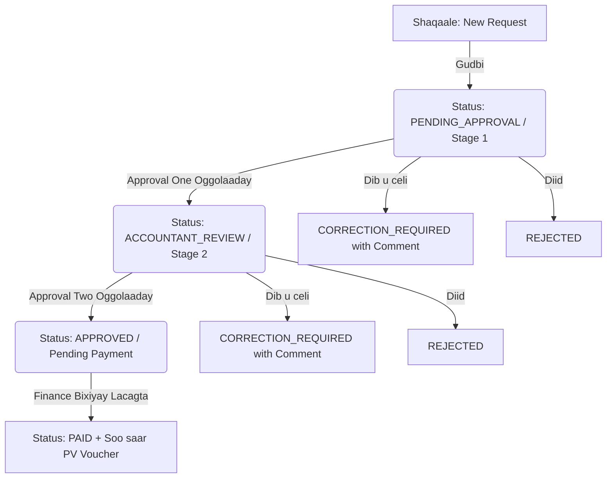

# 📋 QORSHAHA HUGELINTA & HORUMARINTA (PLANUPDATE.MD)
**Mashruuca:** Somtel & Bluekom Petty Cash Management System  
**Isha Fikradaha & Naqshadda:** Claude Artifact (*Petty Cash Office*)  
**Taariikhda:** 2026-10-22  
**Hadafka:** In nidaamkeena hadda jira (NestJS, Prisma, PostgreSQL, React, Vite, TailwindCSS) lagu kordhiyo dhammaan sifooyinka, xawaaraha, naqshadda heerka sare ah (Aesthetics), iyo hab-raaca xisaabeed ee ku jira Claude Artifact-ka, **iyadoon waxba laga beddelayn Tech Stack-ka, lagana ilaalinayo in koodhkii hore ama database-ku jabo**.

---

## 1. 🔍 IS-BARBARDHIG: MAXAA INOO DHAN OO MAQAN?

| Sifo / Qeyb | Nidaamkeena Hadda (Current App) | Claude Artifact (*Petty Cash Office*) | Qorshaha Wax-ka-qabashada (Action Plan) |
| :--- | :--- | :--- | :--- |
| **Tech Stack** | NestJS 11 + Prisma 6 + PostgreSQL + React 18 + Tailwind | Single-file JS + Claude in-memory DB | **Sugi tech stack-keena hadda jira**, maadaama uu yahay production enterprise-grade. |
| **Design & UI** | Tailwind modern UI, light/dark | Navy Blue (`#0B1F4D`) + Signal Gold (`#F5B700`), IBM Plex Mono font | **Ku kordhi Frontend-ka**: Monospace numbers (`IBM Plex Mono`), palette-ka Navy/Gold, iyo cardified responsive tables. |
| **Approval Flow** | 1-Tier: Employee ➔ Accountant Review ➔ Approved | **2-Tier Approval**: Initiator ➔ Approval One ➔ Approval Two ➔ Finance/Paid | **Ku dar 2-tier approval** iyadoon jabinayn statuses-ka hore ee Prisma. |
| **Payment Voucher (PV)** | Rasiid guud / Payment record | **PV rasmi ah oo leh Lambar gaar ah (`PV-BK-2026-0001`), Lacagta oo Qoraal ah (Words), iyo 3 Saxiix** | **Samee PDF Generator & Payment Voucher view** (jspdf + number-to-words + signature block). |
| **Gaadiidka (Vehicles)** | RequestType: FUEL/MAINTENANCE kaliya | **Liiska Baabuurta Shirkadda (Taargooyinka, Model-ka, Gobolka)** | **Ku dar module fudud ama field loogu talagalay Vehicle Plates** si shidaalka loogu xiro baabuurka saxda ah. |
| **Lambarrada Codsiga** | `PC-YYYYMMDD-XXXX` | `PCR-BK-NG-0001` (Shirkadda + Gobolka + Lambarka) | **U habee Numbering-ka** qaab gobolka iyo shirkadda laga dhex garanayo. |
| **Fund Alerts** | Fund Ledger & Balance | **Digniin toos ah (Low Balance Alert: e.g. < $300)** | **Ku dar Top-bar banner & Notification** marka sanduuqa shirkaddu ka hoos maro threshold-ka. |
| **Users & Roles (RBAC)** | Strict Authentication (SUPER_ADMIN, ACCOUNTANT, EMPLOYEE) | Sandbox "View as..." (Demo only) | **Sii wad nidaamkeena dhabta ah ee adag**. Qof kasta wuxuu galayaa koontadiisa rasmiga ah si Audit Trail-ku u noqdo 100% mid sharci ah oo la isku halleyn karo. Wax "View as" ah laguma darayo system-ka. |

---

## 2. 🏗️ NAQSHADDA & UI-GA (AESTHETICS & THEME UPGRADE)

Claude artifact-ku wuxuu leeyahay muuqaal xisaabeed (Financial Ledger look) oo aad u nadiif ah:

```
┌────────────────────────────────────────────────────────────────────────┐
│ [≡] Dashboard   [● Bluekom ▼] [☀/🌙] [🔔 (2)]        Admin (Abshir Q.)│
├────────────────────────────────────────────────────────────────────────┤
│ ┌──────────────────────┐ ┌────────────────────┐ ┌────────────────────┐ │
│ │ BLUEKOM CASH FLOAT   │ │ TOTAL SPENT (OCT)  │ │ PENDING APPROVALS  │ │
│ │ $2,450.00            │ │ $1,180.00          │ │ 3 Requests ($420)  │ │
│ │ (Threshold: $300) OK │ │ 12 Transactions    │ │ Needs Attention    │ │
│ └──────────────────────┘ └────────────────────┘ └────────────────────┘ │
│                                                                        │
│ ┌────────────────────────────────────────────────────────────────────┐ │
│ │ RECENT REQUESTS                               [+ New Request]      │ │
│ │ PCR-BK-NG-0042  Generator Fuel (JI119)   $180.00  [Awaiting A2]   │ │
│ │ PCR-BK-BR-0041  Office Refreshments       $45.00  [Approved & PV] │ │
│ └────────────────────────────────────────────────────────────────────┘ │
└────────────────────────────────────────────────────────────────────────┘
```

### Waxyaabaha Lagu Darayo Frontend-ka:
1. **Fonts:** Ku dar `IBM Plex Mono` lacagaha iyo lambarrada (`tabular-nums`), si tiirarka xisaabtu ay toos isu hoos fariistaan (alignment).
2. **Auto-fit KPI Numbers:** Ku dar function-ka `fitKpis()` si tirooyinka waaweyn ee lacagtu aysan marnaba sanduuqa (card-ka) uga bixin ama u kala jabin.
3. **Cardified Responsive Tables:** Mobilada iyo shaashadaha yaryar miisasku waxay isu beddelayaan kaarar (Cards) akhristu u sahlan tahay.
4. **Shirkadaha (Company Pill Indicator):**
   * **Bluekom:** Deep Royal Blue badge (`#1F5FBF`).
   * **Somtel:** Warm Vibrant Orange/Amber badge (`#C2571A`).

---

## 3. 🔄 HAB-RAACA OGGOLAANSHAHA (2-TIER APPROVAL WORKFLOW)

Si aynaan u jabinayn koodhkii hore ee backend-ka, waxaan u habeynaynaa qaab waafaqsan `RequestStatus` ee hadda jira:



* **Faa'iidada:** Statuses-ka Prisma schema (`PENDING_APPROVAL`, `ACCOUNTANT_REVIEW`, `APPROVED`, `PAID`, `CORRECTION_REQUIRED`, `REJECTED`) horey ayay database-ka ugu jiraan! Waxba kama beddeleyno database enum-ka; kaliya UI-ga iyo habka loo kala oggolaanayo ayaa loo magac-bixinayaa **Stage 1 (Approval One)** iyo **Stage 2 (Approval Two / Head of Accounting)**.

---

## 4. 📄 PAYMENT VOUCHER (PV) & NUMBER IN WORDS

Mid ka mid ah sifooyinka ugu weyn ee Claude artifact-ku leeyahay waa soo saarista **Payment Voucher (PV)** rasmi ah oo la daabacan karo ama PDF loo soo rogan karo.

### Qaab-dhismeedka Voucher-ka:
1. **Header:** Astaanta shirkadda (Bluekom ama Somtel), Cinwaanka, iyo Lambarka PV (`PV-BK-2026-0001`).
2. **Faahfaahinta:** Taariikhda, Magaca qaataha (`receiverName`), Taleefanka, Gobolka, Madax-kharashka (`BudgetHead`), iyo sababta (`Purpose`).
3. **Qaddarka oo Qoraal ah (Amount in Words):**
   * Tusaale: `$1,250.50` ➔ *"One thousand two hundred and fifty US dollars and fifty cents only"*.
4. **3-da Saxiix ee Rasmiga ah (Signature Blocks):**
   * **Prepared By:** Accountant / Cashier (Abshir Qasim)
   * **Verified By:** Internal Auditor / Supervisor (Mohamoud Abdullahi)
   * **Approved By:** DG Telecom / Head of Accounting (Abdijabar Jama)

---

## 5. 🚗 DIIWAANGELINTA GAADIIDKA (VEHICLE FLEET TRACKING)

Kharashka ugu badan ee Petty Cash wuxuu galaa **Shidaalka (Fuel)** iyo **Dayactirka Gaadiidka (Vehicle Maintenance)**.
* **Waxaa lagu kordhinayaa:**
  * Setting/Table fudud oo lagu keydiyo baabuurta shirkadda:
    * Taargada (Plate Number): tusaale `JI119`, `XH174`, `GM461`, `QK466`.
    * Nooca (Model/Type): tusaale `Toyota Noah`, `Toyota Probox`.
    * Gobolka (Region): `Nugaal`, `Bari`, `Mudug`, `Sanaag`.
    * Shirkadda (Company): `Bluekom` ama `Somtel`.
  * Foomka codsiga (Request Form): Marka qofku doorto Budget Head = *Transportations* ama *Repair of Vehicles*, waxaa si toos ah ugu soo baxaya dropdown uu ka doorto taargada baabuurka ama uu ku qoro.

---

## 6. 🛡️ AMNIGA & XAQIIJINTA DOORARKA RASMIGA AH (STRICT RBAC & AUDIT INTEGRITY)

* **Go'aanka Saxda Ah:** Wax "View as..." ama "Impersonation" ah **kuma soo darayno system-ka**, sababtoo ah:
  1. Claude artifact-ka wuxuu "View as" u isticmaalayay oo kaliya demo yar oo qolada management-ku ku tijaabiyaan UI-ga maadaama uusan lahayn dhabarka dambe (Real Backend & Database).
  2. Nidaamkeena dhabta ah (Production System) wuxuu ku dhisan yahay **Strict JWT Authentication**, **Hashed Passwords**, iyo **Audit Logs** qaanuuni ah.
  3. Qof kasta (Admin, Accountant, Employee) wuxuu ku galayaa koontadiisa rasmiga ah si Audit Trail-ku u xaqiijiyo qofka dhabta ah ee ficil kasta sameeyay (Oggolaaday, Diiday, ama Lacagta bixiyay).

---

## 7. 🚀 QORSHAHA FULINTA EE WEJIGA LEH (PHASED ROADMAP)

### Wejiga 1-aad: Naqshadda & Muuqaalka Xisaabeed (Aesthetics & Typography)
* Ku dar Google Font: `IBM Plex Mono` tirooyinka xisaabaadka (`tabular-nums`) si ay toos isu hoos fariistaan.
* Cusbooneysii palette-ka: **Navy Blue** (`#0B1F4D`), **Signal Gold** (`#F5B700`), **Bluekom Royal Blue**, iyo **Somtel Orange**.
* Ku dar function-ka `words(amount)` ee lacagta u beddelaya qoraal Ingiriis ah.

### Wejiga 2-aad: Payment Voucher (PV) & Daabacaadda PDF
* Dhis component-ka Payment Voucher (`PaymentVoucherModal.tsx`).
* Ku dar badhanka **"Print / Download PV"** codsiyada la bixiyay (`PAID`).
* Ku xardh 3-da saxiix ee rasmiga ah (Prepared, Verified, Approved).

### Wejiga 3-aad: Gaadiidka & Digniinta Sanduuqa (Fleet & Low-balance Alerts)
* Foomka codsiga (Request Form) ku dar dropdown-ka taargooyinka baabuurta shirkadda marka la codsanayo shidaal ama dayactir.
* Ku dar dashboard-ka digniinta *"Cash Fund is low: below $300 threshold"* marka balance-ku hoos u dhaco.
